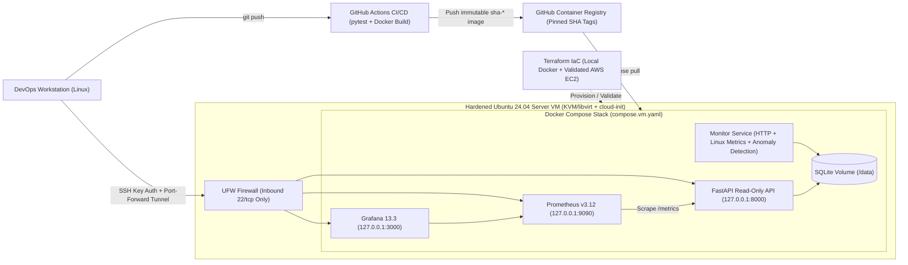
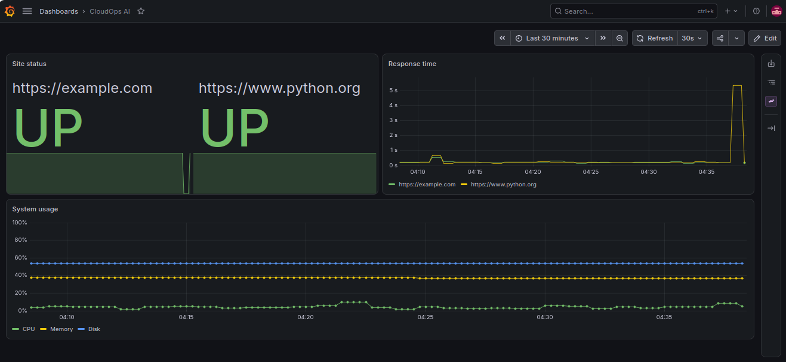

# CloudOps AI — Intelligent Website & Infrastructure Monitoring Platform

End-to-end observability, anomaly detection, containerization, CI/CD, and hardened server deployment built to practice production DevOps engineering workflows.

## Architecture


## Dashboard Preview


## Tech Stack

| Layer | Tools Used |
|---|---|
| Application & Monitoring | Python 3, FastAPI, Uvicorn, SQLite, pytest |
| Anomaly Detection & Triage | Statistical baselines, scikit-learn Isolation Forest, rule-based + optional LLM incident summaries |
| Observability | Prometheus (`prom/prometheus:v3.12.0`), Grafana (`grafana/grafana:13.3.1`) |
| Containers & CI/CD | Docker, Docker Compose v2, GitHub Actions, GitHub Container Registry (GHCR) |
| Server Hardening & IaC | Ubuntu 24.04 Cloud Image, KVM/libvirt, `cloud-init`, Ed25519 SSH keys, UFW, Terraform |

## Implemented Scope vs. Optional / Future Roadmap

### Implemented
* **Synthetic & Host Monitoring:** Scheduled HTTP uptime/latency checks with timeouts, SQLite incident history, alerting, and Linux CPU/RAM/disk/process metrics.
* **Anomaly Detection & Read-Only API:** Statistical latency detection, Isolation Forest ML model, FastAPI read-only endpoints, and automated `pytest` test suite.
* **Observability Stack:** Prometheus scraping and provisioned Grafana dashboards running via Docker Compose.
* **CI/CD Pipeline:** GitHub Actions runs tests on push and publishes commit-SHA-tagged images to GHCR (`ghcr.io/vaibhav81889/cloudops-ai:sha-*`).
* **Hardened Server Deployment:** Bootstrapped Ubuntu 24.04 server via `cloud-init` (`infra/vm/user-data.example.yaml`) with key-only SSH, disabled password login, UFW default-deny firewall (`22/tcp` only), `chmod 600 .env` secrets, and loopback-only service ports accessed via SSH tunnel.
* **Infrastructure as Code:** Local Docker lifecycle managed with Terraform (`infra/terraform/local`) and an equivalent AWS EC2 + Security Group configuration (`infra/terraform/aws`) with IMDSv2, encrypted `gp3` volume, and CIDR validation (`terraform validate` verified offline).

### Optional / Future Enhancements
* **Live AWS Deployment:** Apply `infra/terraform/aws` to an AWS account in `ap-south-1` with a remote state backend (S3 + locking).
* **LLM-Assisted Triage & Safe Automation:** Optional LLM incident summaries layered over rule-based diagnostics; AI strictly **recommends** actions for human approval before any allowlisted auto-recovery is ever enabled.

## Security & Reliability Practices
* **Immutable Image Tagging:** Production Compose (`compose.vm.yaml`) pulls explicit `sha-<commit>` tags rather than mutable `:latest`.
* **Least-Privilege Networking:** FastAPI (`8000`), Prometheus (`9090`), and Grafana (`3000`) bind only to `127.0.0.1` and are accessed over an encrypted SSH tunnel instead of exposing admin UIs to the public internet.
* **Secret Hygiene:** `.env` files, SSH keys, and Terraform state files (`*.tfstate`, `*.tfvars`) are excluded via `.gitignore`; server `.env` uses `chmod 600`.
* **IaC Guardrails:** Terraform rejects `0.0.0.0/0` on SSH port 22 via a custom variable `validation` block and enforces EC2 IMDSv2 (`http_tokens = "required"`).

## Quick Start

### 1. Local Development (Docker Compose)
```bash
cp .env.example .env   # or create .env with GRAFANA_ADMIN_PASSWORD
chmod 600 .env
docker compose up -d --build
```

### 2. Server VM Deployment (Pinned GHCR Image)
```bash
# On the hardened Ubuntu server inside ~/cloudops-ai
cat <<'ENV' > .env
CLOUDOPS_TAG=sha-7256243
GRAFANA_ADMIN_PASSWORD=ReplaceWithAStrongPassword
ENV
chmod 600 .env

docker compose -f compose.vm.yaml pull
docker compose -f compose.vm.yaml up -d
```

Open an SSH tunnel from your workstation:
```bash
ssh -i ~/.ssh/cloudops_vm -N \
  -L 8000:127.0.0.1:8000 \
  -L 9090:127.0.0.1:9090 \
  -L 3000:127.0.0.1:3000 \
  deploy@<SERVER_IP>
```
Access FastAPI at `http://localhost:8000/docs`, Prometheus at `http://localhost:9090/targets`, and Grafana at `http://localhost:3000`.

### 3. Validate Terraform (No AWS Account Required)
```bash
cd infra/terraform/aws
terraform init -backend=false
terraform validate
```
